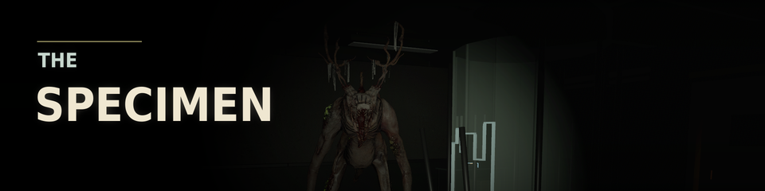

# The Specimen

A facility horror game built with Bevy.

## Play the game

[](https://alexjercan.itch.io/the-specimen)

[Play The Specimen on itch.io](https://alexjercan.itch.io/the-specimen) - find three fuses, open the exit, and escape.

## Quickstart

```bash
cargo run
```

## GitHub releases

Pushing a `vX.Y.Z` tag builds and publishes the Normal Linux, Windows, and HTML5 archives. To publish a Halloween build instead, first add a `## [X.Y.Z]` entry to `CHANGELOG.md` and push a `vX.Y.Z-halloween` tag at a commit containing the `halloween` feature. In GitHub Actions, open **release** > **Run workflow**, enter that tag, and select **halloween** from **Release build variant**. This builds all three platforms with the feature and publishes a separate prerelease. The tag push alone does not build the Halloween variant. Existing GitHub Releases are not overwritten. No tag or release is created by this setup.
